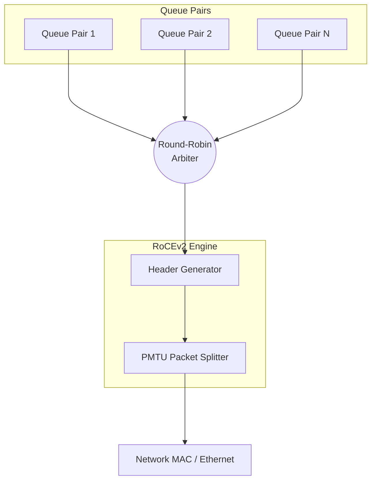

# Lightweight RoCEv2 Stack


## 📖 What is RoCEv2?

**RDMA over Converged Ethernet (RoCEv2)** is a network protocol that allows direct memory access over an Ethernet network. It allows a machine to write data directly into the memory of another machine, bypassing the CPU, operating system, and cache completely. This means **incredibly fast speeds and ultra-low latency**.

## 🚀 Overview of This Project

This project provides a **highly stripped-down, TX-only RoCEv2 endpoint** implemented in SystemVerilog. It is specifically designed to be extremely lightweight and scalable for hardware designs (like FPGAs) that need to blast data across a network as fast as possible without the bloat of a full network stack.

- **Supported Operations**: Currently supports Reliable Connection (RC) **RDMA WRITE** operations (with and without IMMEDIATE) and **RC SEND** operations.
- **RX Path**: The receive (RX) path is intentionally minimalistic, existing purely to process ACKs, NAKs, and Congestion Notification Packets (CNPs).

### Architecture Overview


*Multiple Queue Pairs (QPs) are merged using a Round-Robin Arbiter before headers are generated and sent out to the network.*

## 🛠️ Supported Hardware

This IP has been designed for cutting-edge Xilinx FPGAs:
- **VCU118**: 10G, 25G, and 100G (URAM retransmission buffer).
- **VPK180**: 400G (URAM retransmission buffer).
- **VHK158**: 400G (URAM and HBM retransmission buffers).

## ⚙️ How It Works

### Connection Management (CM)
A Connection Manager is implemented via simple UDP packets. This allows easy setup of Queue Pairs without complex software stacks.

### Retransmissions and State
A QP state table is implemented efficiently in LUTRAM. If a packet is lost, the hardware natively handles retransmission caching using URAM or HBM buffers.

## ⚠️ Known Limitations
- The Versal HBM throughput is currently limited to `4 × 69 Gbps` due to NoC slave port limitations.
- The HBM buffer size is currently limited to 26-bits.
- Only a single MAC is supported per example design.
- Slow control is IPbus-based (though registers are exposed at the top level for custom interfaces).

## 🧪 Receiving Data

We provide a reference receiver application called **[feroce-rs](https://github.com/Mmiglio/feroce-rs)** written in Rust. It implements the Connection Manager protocol and provides an easy-to-use CLI to test this firmware.

To start a transfer using `feroce-cli`:
```bash
./target/release/feroce-cli recv \
    --rdma-device mlx5_2 --gid-index 3 \
    --buf-size 16384 --num-buf 128 \
    --active --remote-addr <FPGA_IP> --remote-port 0x4321 \
    --num-streams 1
```

## 📫 Contacts
- **Gabriele Bortolato** (gabriele.bortolato@cern.ch)
- **Matteo Migliorini** (matteo.migliorini@cern.ch)
